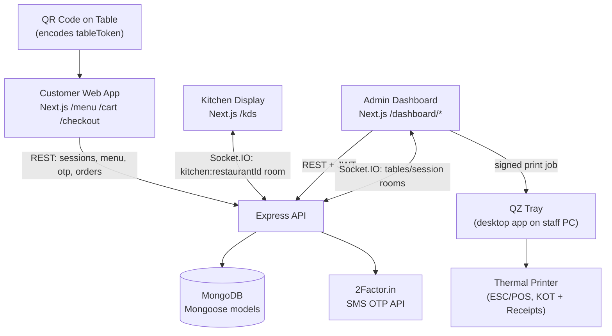

# SmartQR — QR-Based Restaurant Ordering & POS System

A full-stack restaurant operations platform: customers scan a table QR code, browse the menu, and order from their phone, while staff run the kitchen, billing, inventory, and back-office accounting from a single admin dashboard. Built for a real café ("MAXIBREW", Hyderabad) rather than as a generic demo — the codebase is single-tenant today (one hardcoded `restaurantId`) even though most schemas are already shaped for multi-tenancy.

This is not a toy project. It's a working dine-in ordering + POS + light-ERP system with real third-party integrations (SMS OTP, thermal receipt printing), live Socket.IO updates across customer/kitchen/admin, and a genuinely large admin surface (GST compliance, inventory, settlements, investment & expense tracking). Some areas are clearly staged for future work — those are called out explicitly below rather than glossed over.

---

## 1. What this actually is

| | |
|---|---|
| **Category** | Restaurant dine-in ordering system + point-of-sale + admin back-office (not e-commerce, not a marketplace, not multi-restaurant SaaS *yet*) |
| **Customers** | Diners at a table, ordering via a scanned QR code, on their own phone |
| **Operators** | A single restaurant's staff — kitchen, waiters, cashier/admin — via a role-gated web dashboard |
| **Stack** | Next.js 16 (App Router, React 19) frontend, Express + MongoDB (Mongoose) backend, Socket.IO for real-time, all in a single monorepo |

The three customer-facing personas map to three separate Next.js route groups:

- `(customer)` — the diner's menu, cart, checkout, order tracking (phone-first UI)
- `(kitchen)` — a Kitchen Display System (KDS) for order fulfillment
- `(admin)` — the restaurant's management dashboard (JWT-gated, staff login)

---

## 2. Architecture



- **Frontend:** one Next.js app serving all three personas via route groups, with Zustand stores (`cart-store`, `session-store`, `group-order-store`, `printer-store`, `auth-store`, `order-store`) instead of React Context for cross-page state.
- **Backend:** Express app (`backend/src/app.js`) exposing versionless REST routes under `/api/*`, with everything under `/api/admin/*` gated by a JWT auth middleware mounted once (`app.use("/api/admin", requireAuth)`).
- **Real-time:** a single Socket.IO server (`backend/src/sockets/socket.js`) with room-per-concern: `kitchen:<restaurantId>`, `session:<sessionId>`, `order:<orderId>`, plus tables/settlement broadcast rooms for the admin dashboard.
- **Database:** MongoDB via Mongoose, with `restaurantId` as a string field on nearly every collection — the multi-tenancy hook is there, but the frontend hardcodes a single `RESTAURANT_ID` constant, so today it only runs one restaurant at a time.

---

## 3. Core customer workflow (traced through the code)

### QR scan → session → menu

1. The physical QR code encodes a URL with `?table=<tableToken>`.
2. `session-store.ts`'s `ensureSession()` is the **only** place that reads that URL param. It either reuses a still-valid cached session or calls `POST /api/sessions` to create a new one, tied to that `tableToken` for a TTL controlled by `SESSION_TTL_HOURS`.
3. The menu page (`(customer)/menu/page.tsx`) reads `restaurantId`/`tableToken` from the session store — never from `useSearchParams()` directly — so table identity can't be spoofed by editing the URL mid-session.
4. Table tokens are resolved server-side (`Table.findOne({ token })`); the `restaurantId` is always derived from the matched Table document, never trusted from the client — a spoofed `restaurantId` in the request body can't smuggle in a fake table.

### Ordering, modifiers, and group ordering

- Menu items support **modifier groups** (e.g. required "Sauce" choice) — validated server-side in `orderService.resolveLineModifiers()` for every order line, so a required modifier can never be skipped by a malicious/buggy client, regardless of order source.
- **Group ordering**: everyone who scans the same table's QR lands in the same `(restaurantId, tableToken)` pair, which doubles as a shared cart's group ID (no invite code needed). This is deliberately **in-memory only** on the backend (a `Map`, not a Mongo collection) — it resets on server restart, a documented trade-off for simplicity.
- A **"Call Waiter"** button emits a socket event straight into the kitchen's room.

### Checkout — phone verification is real, not decorative

Checkout requires OTP verification of the customer's phone number, backed by the **2Factor.in** SMS API:

```
Customer enters phone → POST /api/otp/send → 2Factor sends SMS, returns session id
                                              (stored on PhoneVerification, keyed by phone)
Customer enters code  → POST /api/otp/verify → verified against 2Factor
                                              → short-lived verification token issued
Place order            → POST /api/orders (Authorization: Bearer <verification token>)
                                              → verifyPhoneToken middleware re-checks the
                                                token against the phone on the order body
                                              → orderService.validateAndBuildOrder runs
```

Notably, the backend never sees or stores the actual OTP code — only the session id 2Factor hands back, and later a random verification token minted server-side. That token — not the OTP — is what actually authorizes order creation.

> **Worth flagging:** a comment inline in `orderService.validateAndBuildOrder` says name/phone are only presence-checked with "no OTP/SMS verification" — but the route (`orderRoutes.js`) does wire `verifyPhoneToken` ahead of `createOrder`, and the checkout UI does drive a full send/verify OTP flow. The route-level middleware is what actually runs; the comment appears to be stale documentation left over from an earlier iteration, not the current behavior.

### Order → Kitchen → Table session → Billing

```
Order created (status: pending)
   → syncTableOccupancyForOrder(): first order of a visit auto-opens a
     TableSession (assigns a Daily Token Number for shouting out orders
     without reading a table number aloud) and marks the Table "occupied";
     later orders in the same visit just attach to the existing session
   → emitNewOrder() broadcasts to kitchen:<restaurantId> and session:<sessionId>
Kitchen Display (KDS) advances items independently: pending → preparing →
   ready → completed (or cancelled), per line item — not just per order
   → Order.status is *derived* from its items' statuses, never set directly
Customer's Active Orders / Order Success page gets live status via Socket.IO
Admin "Tables" page: cashier prints the bill (billPrinted gate for cash),
   picks a payment method, "Submit Bill" locks it into a Settlement record
   → Settlements page collects payment and closes out the TableSession
   → Table status returns straight to "available" (skips a "cleaning" step)
```

Every order is a **snapshot** — item name, price, GST slab, and modifier choices are copied onto the order at placement time, so editing the live menu later never rewrites historical orders or reports.

---

## 4. Feature inventory (by admin dashboard section)

Reflects what's actually implemented, not just linked in navigation:

| Section | Status | Notes |
|---|---|---|
| Live Orders / Kitchen Display | ✅ Working | Real-time via Socket.IO, item-level status |
| Tables & Table Sessions | ✅ Working | QR token → table resolution, occupancy lifecycle, Daily Token Numbers |
| Reservations | ✅ Working | Create/check-in/no-show/cancel, check-in opens a TableSession |
| Menu Management | ✅ Working | Categories, items, modifier groups, GST slab per item |
| Offers/Discounts | ✅ Working | Manually applied per-bill, frozen onto the bill at apply time |
| GST Management | ✅ Working | Inclusive/exclusive modes, per-slab computation, CGST/SGST split (IGST modeled but unused — everything is treated as intra-state today) |
| Settlements & Billing | ✅ Working | Bill lock → cashier collection → cascade delete support |
| Payments Analytics | ✅ Working | Cash-only today — see Payments caveat below |
| Stock / Inventory Management | ✅ Working (recently un-404'd) | Ingredients, stock movements, alerts — was previously wired on the frontend but 404ing because the routes weren't mounted in `app.js`; fixed as groundwork for the Investment module's stock auto-sync |
| Investment & Expenses | ✅ Working | Vendors, purchases (with GST + invoice upload), expenses, recurring expenses, assets, profit analysis, exportable reports (PDF/Excel) — admin-role-gated |
| Staff Management | ✅ Working | Role: `admin` \| `kitchen` \| `waiter` (no separate "owner" role — `admin` is treated as the owner tier) |
| Customer records / order history | ✅ Working | Built from completed orders, keyed by phone |
| Analytics / Peak Hours | ✅ Working | Revenue breakdowns, peak-hour aggregation |
| Reviews | ❌ **Not implemented** | Dashboard page exists as a static "coming soon" shell; explicitly commented in code as having no backing data model yet |
| Online/card/UPI payment gateway | ❌ **Not implemented** | `Order.paymentMethod` schema only allows `"cash"`; UPI/card fields on `TableSession`/`Settlement` are manually entered by the cashier (a reference number typed in after they see a successful UPI/card payment elsewhere), not a live payment gateway integration |
| Aggregator integration (Swiggy/Zomato) | ⚠️ **Schema only** | `Order.orderSource` enum includes `"SWIGGY"`/`"ZOMATO"` values, but no code path or webhook actually creates orders from those platforms — it's a forward-looking enum value, not a working integration |

---

## 5. Third-party integrations

Only integrations actually present in the code — no invented ones:

### 2Factor.in (SMS OTP)
- **Why:** verifies a customer's phone number before an order can be placed.
- **Where:** `backend/src/config/twoFactor.js`, `services/otpService.js`, `controllers/otpController.js`, `middleware/verifyPhoneToken.js`.
- **How:** plain HTTP GET calls to `https://2factor.in/API/V1/<apiKey>/SMS/91<phone>/AUTOGEN` to send, and `.../SMS/VERIFY/<sessionId>/<otp>` to verify.
- **Auth:** a single API key (`TWOFACTOR_API_KEY`) in the request path.
- **Data flow:** the backend never sees or stores the OTP itself — only the opaque session id 2Factor returns, which is later used to check success. On success, the backend mints its own random verification token (`crypto.randomBytes`) that the frontend must carry through to checkout.
- **Error handling:** any non-`"Success"` verify result is treated as "wrong/expired code," not a system error; only network/API failures throw.

### QZ Tray (desktop print bridge → thermal printers)
- **Why:** prints Kitchen Order Tickets (KOTs) and customer bills/receipts to real ESC/POS thermal printers from the browser, which browsers can't do directly.
- **Where:** `backend/src/config/qzCert.js` + `controllers/qzController.js` (signing) and `frontend/src/lib/printer/*` (`qzClient.ts`, `escpos.ts`, `kot.ts`, `receiptLayout.ts`, `imageRaster.ts`).
- **How:** the backend holds a certificate/private-key pair and signs each print request server-side (the private key is never sent to the browser); the frontend connects to a locally-running QZ Tray application and sends signed, pre-formatted ESC/POS byte sequences to it.
- **Auth:** certificate-based trust — once staff accept QZ Tray's "Remember this decision" prompt for this app's certificate, subsequent print jobs are silent.
- **Why it matters:** without a real cert/signature, QZ Tray would re-prompt on every single print job — a previously blank-certificate implementation is called out in comments as the bug this fixed.

### MongoDB (Atlas or self-hosted)
- Primary datastore via Mongoose; `docker-compose.yml` provides a local Mongo 7 container for development, with the `.env` documented to swap to an Atlas URI for production.

No Stripe/Razorpay, Cloudinary, AWS, Firebase, Twilio, or Redis were found anywhere in the codebase — payments are cash/manual-reference only, and file uploads (menu images, invoice attachments) go through local disk storage via **Multer**, served back out at `/uploads` — not a cloud object store.

---

## 6. Data model (high level)

```
Restaurant (single-tenant profile: name, address, GST number)
   └─ Table ── token (QR-encoded) ──> TableSession (one active session per table)
                                          ├─ orderIds[] ──> Order (snapshotted items, GST, status)
                                          ├─ appliedOffer (frozen snapshot of an Offer)
                                          └─ Settlement (bill lock → payment collection)
   └─ Staff (admin | kitchen | waiter) ──> JWT auth
   └─ MenuItem ── Category
              └─ modifierGroups[] (e.g. Sauce)
              └─ RecipeIngredient ──> Ingredient (Stock Management)
   └─ Customer (derived from completed orders, keyed by phone)
   └─ Reservation ──(check-in)──> TableSession
   └─ Vendor ──> Purchase / Expense / Asset / RecurringExpense (Investment & Expenses module)
   └─ GstSettings (per-restaurant tax configuration)
```

Key relationships worth calling out:

- **Order** is deliberately a self-contained snapshot (menu item name/price/GST slab/modifiers all copied in at order time) — historical orders are immune to later menu or GST-setting edits.
- **TableSession vs. Session** are two distinct, easy-to-confuse models: `Session` is a short-lived QR *browsing* session that expires on a TTL and just attributes an order to a scan; `TableSession` represents the actual physical dining occupancy — created on the first order, and can span multiple `Session`s and multiple orders.
- A partial unique index enforces **only one active `TableSession` per table** at the database level (`{tableId, status: "active"}` unique), and a separate partial unique index enforces the Daily Token Number can never collide for the same restaurant on the same business day — both are DB-level guarantees, not just application logic.
- Compound indexes (`{restaurantId, status, placedAt}`, etc.) exist specifically because the dashboard's live-orders widget, analytics, and revenue aggregations all filter/sort on these same fields together — called out in code comments as a deliberate performance fix.

---

## 7. Notable engineering details

- **Item-level order management:** each line item in an order has its own status lifecycle (`pending → preparing → ready → completed`, or `cancelled`), and the parent order's overall status is *computed* from its items rather than set directly — so the two can never disagree.
- **Cash-flow safety on cancellations:** cancelling an item recomputes the order's subtotal/tax/total by re-summing the *remaining* lines using each line's own frozen GST snapshot — never by re-deriving today's GST rate, which could silently drift from what was actually charged.
- **Revenue exclusion, not deletion:** if a settlement is deleted, its orders are kept for historical reference but flagged `excludedFromRevenue: true` so they stop counting in dashboards/analytics without rewriting order history.
- **Best-effort side effects don't block the customer:** table-occupancy sync and stock-deduction on order placement are wrapped so a failure there never blocks or rolls back a successful order — the customer-facing flow keeps working even if a downstream admin feature is degraded.

---

## 8. Security notes (found during this analysis — please act on these before deploying)

This is worth surfacing explicitly rather than silently ignoring in a "professional" README:

- **A `.env` file is committed at the repository root** and contains a live `MONGODB_URI` connection string. This should be removed from version control, the credential rotated, and the path added to `.gitignore` immediately.
- **`backend/certs/` contains real, generated key material committed to git** — including `private-key.pem` and a file literally named `qz-root-ca.key.KEEP-SAFE-DO-NOT-DEPLOY`. `backend/.env.example` also embeds a full working certificate and private key as a "for-instance" example rather than a placeholder. Anyone who clones this repo has the actual signing key. These should be regenerated, the old ones revoked, and removed from git history (not just deleted in a new commit).
- Order pricing is fully recomputed server-side from the menu (never trusted from the client), which is good practice already in place — worth preserving in any future refactor.

---

## 9. Running it locally

```bash
# 1. Start MongoDB (local dev)
docker compose up -d

# 2. Backend
cd backend
cp .env.example .env   # then fill in real values — see Security notes above
npm install
npm run seed            # optional: loads demo menu/table data
npm run dev              # http://localhost:5000

# 3. Frontend
cd frontend
npm install
npm run dev              # http://localhost:3000
```

Required environment variables (`backend/.env`): `MONGODB_URI`, `PORT`, `CLIENT_ORIGIN`, `SESSION_TTL_HOURS`, `JWT_SECRET`, `TWOFACTOR_API_KEY`, and `QZ_CERTIFICATE`/`QZ_PRIVATE_KEY` (or local files under `backend/certs/` — generate your own, don't reuse the committed ones).

---

## 10. Tech stack summary

**Frontend:** Next.js 16 (App Router) · React 19 · TypeScript · Tailwind CSS 4 · Zustand · Socket.IO client · Framer Motion · Recharts · qz-tray · jsPDF / xlsx (report export)

**Backend:** Node.js · Express 4 · MongoDB / Mongoose 8 · Socket.IO · JWT (`jsonwebtoken`) · bcryptjs · Multer (local file uploads) · nanoid

**External services:** 2Factor.in (SMS OTP), QZ Tray (thermal printer bridge)
